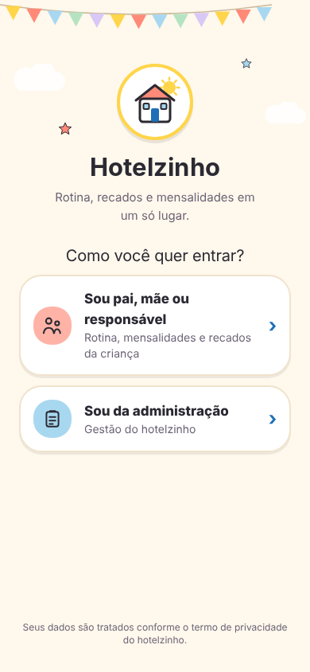
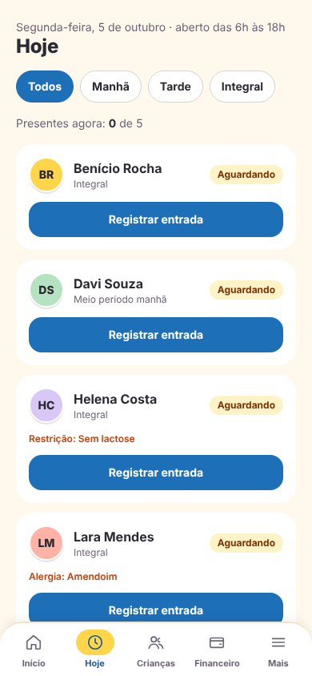
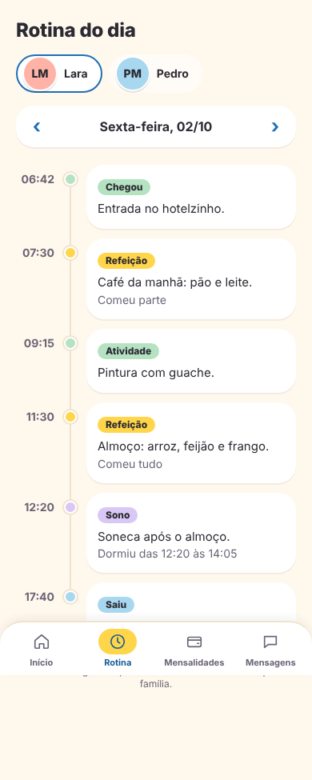

# 🏠 Hotelzinho

Sistema web para gestão de hotelzinho infantil: rotina das crianças, comunicação com as famílias e controle de mensalidades. Funciona no navegador e pode ser instalado no celular.

Projeto de Extensão I — Bacharelado em Sistemas de Informação.

<p>
  
  
  
  
</p>

<sub>Telas com dados fictícios.</sub>

## Funcionalidades

- Área da administração e área da família, com acesso separado por perfil
- Presença e rotina do dia (refeições, sono, atividades, ocorrências e recados)
- Cadastro de crianças e responsáveis, com alerta de alergias e restrições
- Mensalidades com QR Code Pix, envio de comprovante e confirmação pela administração
- Cobrança automática ou individual, edição de valor e exclusão de cobranças
- Comunicados, mensagens e avisos no celular (push)

## Tecnologias

- **Front-end:** React, TypeScript, Vite, Tailwind CSS (PWA)
- **Back-end:** Supabase — PostgreSQL, autenticação, Storage e Edge Functions
- **Segurança:** Row Level Security (cada família acessa só os próprios dados)
- **Testes:** SQL e Playwright

## Estrutura

```
app/                  front-end (React + TypeScript)
supabase/migrations/  banco de dados: tabelas, regras e segurança
supabase/functions/   função de envio de avisos
supabase/tests/       testes do banco
local/                scripts para rodar o banco e os testes localmente
docs/                 resultados dos testes e capturas de tela
```

## Como rodar

```bash
cd app
cp .env.example .env.local   # preencher com a URL e a chave pública do Supabase
npm install
npm run dev
```

Testes do banco (PostgreSQL 15+): `bash local/rodar_testes.sh`
